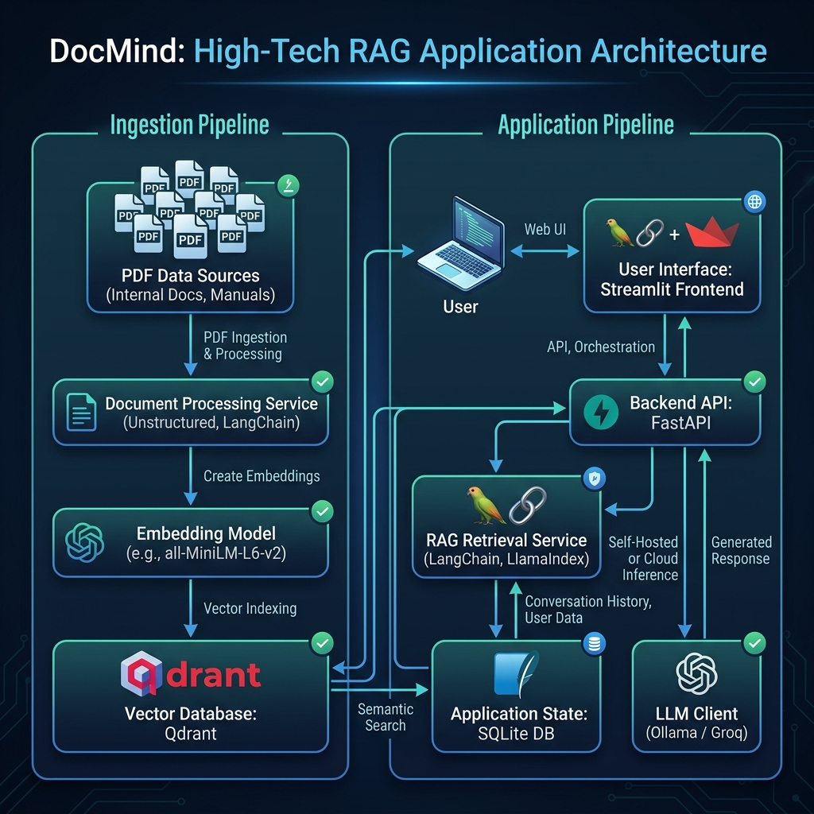

# 🤖 DocMind — Chat with Your Documents

[](https://github.com/AnubhavKiroula/docmind-rag-chatbot/actions/workflows/ci.yml)
[](https://opensource.org/licenses/MIT)
[](https://www.python.org/downloads/)
[](https://www.docker.com/)

DocMind is an enterprise-grade Retrieval-Augmented Generation (RAG) chatbot designed to ingest PDF documents, perform high-dimensional vector embeddings extraction, store vectors in Qdrant, and deliver context-grounded answers via Streamlit UI and FastAPI backend.

---

## 🌐 Live Cloud Demo & Architecture

- **Streamlit Web UI**: [https://docmind-rag-chatbot.streamlit.app](https://docmind-rag-chatbot.streamlit.app)
- **FastAPI Backend (Render)**: [https://docmind-backend.onrender.com](https://docmind-backend.onrender.com)
- **FastAPI Interactive API Docs**: [https://docmind-backend.onrender.com/docs](https://docmind-backend.onrender.com/docs)
- **Vector Database**: Qdrant Cloud Free Tier Cluster

---

## 📌 What It Does

DocMind allows users to upload PDF documents and have natural, context-grounded conversations with their contents. It performs semantic analysis to retrieve only the most relevant text chunks, computes a confidence rating based on retrieval quality, and synthesizes answers locally (via Ollama) or on the cloud (via Groq API) while maintaining full multi-turn chat history.

---

## 🏛️ System Architecture



```text
                      [ INGESTION PIPELINE ]
                      
  +------------------+      +---------------------+      +----------------------+
  |  data/sample/    | ---> |   ingestion/loader  | ---> |  ingestion/chunker   |
  |  (PDF files)     |      | SimpleDirectoryReader|      |  (SentenceSplitter)  |
  +------------------+      +---------------------+      +----------------------+
                                                                    |
                                                                    v
  +------------------+      +---------------------+      +----------------------+
  |  Qdrant Store    | <--- |   ingestion/store   | <--- |  ingestion/embedder  |
  | (Local / Cloud)  |      | (VectorStoreIndex)  |      | (all-MiniLM-L6-v2)   |
  +------------------+      +---------------------+      +----------------------+
  
  
                      [ QUERY & INFERENCE PIPELINE ]
                      
  +------------------+      +---------------------+
  |  Streamlit UI    | ---> |    FastAPI Routes   |
  | (Streamlit Cloud)| <--- |   (/query endpoint)  |
  +------------------+      +---------------------+
                                       |
                                       v
                            +---------------------+      +----------------------+
                            |   QdrantRetriever   | ---> |  Qdrant Database     |
                            | (Retrieve top_k=3)  | <--- | (Local / Qdrant Cloud|
                            +---------------------+      +----------------------+
                                       |
                                       v (chunks + relevance)
                            +---------------------+      +----------------------+
                            | ResponseSynthesizer | ---> |   SQLite Database    |
                            | (Prompt & Confidence|      | (Persistent History) |
                            |  Score Computation) |      +----------------------+
                            +---------------------+
                                       |
                                       v (grounded prompt)
                            +---------------------+      +----------------------+
                            |      LLMClient      | ---> |  Ollama (llama3.2)   |
                            | (Routing/Fallback)  |      |  (Local inference)   |
                            +---------------------+      +----------------------+
                                       |                            | (if offline)
                                       v (answer text)              v
                            +---------------------+      +----------------------+
                            |    FastAPI Response | <--- |  Groq Cloud API      |
                            | (JSON Response API) |      | (llama-3.1-8b-instant)
                            +---------------------+      +----------------------+
```

---

## 🛠️ Tech Stack & Infrastructure

| Tool / Technology | Purpose |
| :--- | :--- |
| **Streamlit** | Interactive chat interface (Deployed on Streamlit Cloud). |
| **FastAPI** | Asynchronous REST API backend engine (Deployed on Render PaaS). |
| **LlamaIndex** | Core orchestration framework for loading, chunking, and indexing. |
| **Qdrant** | Vector database (Supports both local Docker and Qdrant Cloud free tier). |
| **SQLite + SQLAlchemy** | Lightweight file-based persistent storage for conversation history. |
| **all-MiniLM-L6-v2** | Pre-trained Sentence Transformers embedding model running on CPU. |
| **Groq API** | Ultra-fast cloud LLM completions (`llama-3.1-8b-instant`). |
| **Ollama** | Local LLM inference engine (`llama3.2`). |
| **Docker & Docker Compose** | Multi-stage containerization and stack orchestration. |
| **GitHub Actions** | Automated CI/CD pipeline for linting, unit testing, and deployment. |

---

## 🐳 Docker Containerization

DocMind features full multi-stage Docker containerization optimized for small image size and CPU performance.

### Local Docker Stack (Local Qdrant)
Launch the full local containerized stack (Qdrant, Backend, Frontend):
```bash
docker compose up -d
```
Check running containers:
```bash
docker compose ps
```
Services exposed locally:
- **Frontend UI**: [http://localhost:8501](http://localhost:8501)
- **Backend API**: [http://localhost:8000](http://localhost:8000)
- **Qdrant Dashboard**: [http://localhost:6333/dashboard](http://localhost:6333/dashboard)

### Production Docker Stack (Qdrant Cloud)
To run local containers connecting to Qdrant Cloud:
```bash
docker compose -f docker-compose.yml -f docker-compose.prod.yml up -d
```

---

## ⚙️ Environment Variables Reference

| Variable | Required | Default | Description |
| :--- | :--- | :--- | :--- |
| `QDRANT_MODE` | Yes | `local` | Database mode (`local` or `cloud`). |
| `QDRANT_URL` | No | `http://localhost:6333` | Local Qdrant server REST URL. |
| `QDRANT_CLOUD_URL` | Cloud | - | Qdrant Cloud cluster endpoint URL. |
| `QDRANT_API_KEY` | Cloud | - | Qdrant Cloud cluster API key. |
| `QDRANT_COLLECTION_NAME` | No | `docmind_docs` | Target vector collection name. |
| `LLM_MODE` | Yes | `groq` | Default LLM provider (`groq` or `ollama`). |
| `GROQ_API_KEY` | Cloud | - | API key for Groq Cloud LLM inference. |
| `OLLAMA_BASE_URL` | Local | `http://localhost:11434` | Ollama service endpoint. |
| `OLLAMA_MODEL` | Local | `llama3.2` | Ollama target model. |
| `EMBED_MODEL` | No | `sentence-transformers/all-MiniLM-L6-v2` | Embedding model. |
| `ENVIRONMENT` | No | `development` | Runtime environment mode (`development` or `production`). |
| `BACKEND_URL` | UI | `http://localhost:8000` | FastAPI backend URL used by Streamlit frontend. |

---

## 🔄 CI/CD Automation Pipeline

- **Continuous Integration (`.github/workflows/ci.yml`)**:
  - Automatically triggered on push to `main` and `phase/5-docker-cicd-deployment`, and PRs to `main`.
  - **Job 1 (Lint & Format)**: Installs `black` and `flake8`, executes `black --check . --line-length=100` and `flake8 .`.
  - **Job 2 (Unit Testing)**: Installs dev dependencies and runs `pytest` (12 unit tests).
- **Continuous Deployment (`.github/workflows/cd.yml`)**:
  - Automatically triggered upon successful completion of `DocMind CI Pipeline` on `main`.
  - Sends a secure POST request to the Render Deploy Webhook (`RENDER_DEPLOY_HOOK_URL`), triggering instant production zero-downtime deployment.

---

## 📅 Phase 1 - 5 Development Roadmap Summary

- **Phase 1: Ingestion & Vector Storage Pipeline**
  - Built document parser, text chunker (`SentenceSplitter`), HuggingFace embedder, and Qdrant vector indexer.
- **Phase 2: RAG Retrieval & LLM Generation**
  - Implemented `QdrantRetriever`, `LLMClient` (Ollama + Groq fallback), and `ResponseSynthesizer` with confidence scoring.
- **Phase 3: Web UI (Streamlit) & FastAPI Backend with SQLite Persistence**
  - Created FastAPI REST API (`/health`, `/query`, `/conversations`), Streamlit UI, and SQLAlchemy SQLite history persistence.
- **Phase 4: Production Polish, Security & Test Coverage**
  - Implemented rate limiting (`slowapi`), CORS middleware, PDF upload endpoint, and 12 comprehensive unit tests (`pytest`).
- **Phase 5: Containerization, CI/CD Automation & Free Cloud Deployment**
  - Created multi-stage Dockerfiles (`docker/backend.Dockerfile`, `docker/frontend.Dockerfile`), `docker-compose.yml`, `docker-compose.prod.yml`, GitHub Actions CI/CD workflows, Qdrant Cloud integration, Procfile, `render.yaml`, and deployed live production demos.

---

## 🚀 Local Development Setup

### 1. Clone & Set Up Virtual Environment
```bash
git clone https://github.com/AnubhavKiroula/docmind-rag-chatbot.git
cd docmind-rag-chatbot
python -m venv venv
# On Windows:
.\venv\Scripts\activate
# On macOS/Linux:
source venv/bin/activate
```

### 2. Install Development Dependencies
```bash
pip install -r requirements-dev.txt
```

### 3. Run Test Suite & Linters
```bash
python -m black --check . --line-length=100
python -m flake8 .
python -m pytest
```

---

## 📄 License

This project is licensed under the MIT License - see the [LICENSE](LICENSE) file for details.
